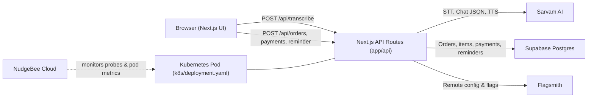

# BhashaBill

Festive vendors take orders by voice and argue about them later. BhashaBill turns the spoken order into a bill the customer can see before the dispute starts.

`Next.js 16` · `Supabase` · `Sarvam AI` · `Flagsmith` · `NudgeBee`

---

## Demo

- **Live app:** TODO
- **Demo video (under 90 s):** TODO

| New Order | Review Bill | Public Bill (`/b/[slug]`) | Dashboard (`/orders`) |
|---|---|---|---|
| `TODO: screenshot` | `TODO: screenshot` | `TODO: screenshot` | `TODO: screenshot` |

---

## The Problem

During festive seasons in India, small sweet shops and catering vendors take custom bulk orders verbally in Kannada, Hindi, Tamil, English, or a mix of languages. Because nothing is written down cleanly at the counter, disputes happen at delivery over item quantities, rates, advances paid, and balance due. BhashaBill gives vendors a fast voice-to-bill workflow so customers see a clear bilingual bill link immediately.

---

## What It Does

- **New Order ([`/new`](app/new/page.tsx)):** Record an order with the browser's `MediaRecorder` in Kannada (`kn`), Hindi (`hi`), Tamil (`ta`), or English (`en`), or use the text-box fallback.
- **Review Bill ([`/review`](app/review/page.tsx)):** Inspect the raw transcript beside an editable itemised table; missing rates are highlighted and block saving until filled, and totals/balance update live in code.
- **Public Bill ([`/b/[slug]`](app/b/[slug]/page.tsx)):** Shareable, no-login bilingual bill page showing original-script and English item names, advance paid, balance due, print-to-PDF ([`PrintBillButton`](components/PrintBillButton.tsx)), and optional spoken readback ([`TtsListenButton`](components/TtsListenButton.tsx)).
- **Dashboard ([`/orders`](app/orders/page.tsx)):** Lists shop orders with `pending`, `overdue`, and `paid` chips, lets the vendor record payments to update balances, and opens prefilled WhatsApp (`wa.me`) reminders.
- **Landing & Shop Profile ([`/`](app/page.tsx), [`/welcome`](app/welcome/page.tsx)):** No login; shop identity (`vendor_key`, name, phone, city) is stored locally on the device via [`lib/client/shop.ts`](lib/client/shop.ts), with a one-click `DEMO_SHOP` (`Lakshmi Sweets, Mysuru` in [`lib/vendor.ts`](lib/vendor.ts)).

---

## How the Sponsors Are Used

### Sarvam AI

Implemented in [`lib/server/sarvam.ts`](lib/server/sarvam.ts) and called from [`app/api/transcribe/route.ts`](app/api/transcribe/route.ts) and [`app/api/tts/route.ts`](app/api/tts/route.ts):

- **Speech-to-Text (`POST /speech-to-text`, model `saaras:v4`):** Sends recorded audio with BCP-47 language hints (`kn-IN`, `hi-IN`, `ta-IN`, `en-IN`), `mode=codemix`, and sweet-shop `keyterms` (e.g. `Mysore Pak`, `Kaju Katli`, `Motichoor Laddu`).
- **Bill Extraction (`POST /v1/chat/completions`, model `sarvam-105b-conversations`):** Extracts strict JSON (`customer_name`, `items` with `name_original` and `name_english`, `quantity`, `unit`, `rate`, `advance_paid`, `due_date_text`, `notes`) validated with `zod`, without letting the model compute totals.
- **Text-to-Speech (`POST /text-to-speech`, model `bulbul:v4-flash`, speaker `shubh_enhi_ads`):** Generates `audio/wav` spoken bill summaries behind the Flagsmith `tts_readback` flag.

### Flagsmith

Implemented in [`lib/server/flagsmith.ts`](lib/server/flagsmith.ts) using `flagsmith-nodejs` (remote evaluation with a 4 s timeout) and used in [`app/api/flags/route.ts`](app/api/flags/route.ts), [`app/api/tts/route.ts`](app/api/tts/route.ts), and [`app/api/orders/[id]/reminder/route.ts`](app/api/orders/%5Bid%5D/reminder/route.ts):

- **`reminder_templates` (JSON remote config):** Stores `{"polite": "...", "firm": "..."}` templates with `{name}`, `{shop}`, `{balance}`, and `{date}` placeholders so reminder wording updates without a redeploy.
- **`reminder_tone_test` (multivariate A/B flag):** Evaluates per customer identity (sanitized `customer_phone` or order `slug`) with traits `is_overdue`, `language`, and `balance` to select `polite` or `firm`. Both the chosen `variant` and rendered `message` are logged to the Supabase `reminders` table.
- **`tts_readback` (boolean flag):** Toggles the spoken bill summary button on `/b/[slug]` and gates `POST /api/tts` (returns `403` when disabled).
- **Fallback behavior:** If `FLAGSMITH_ENVIRONMENT_KEY` is missing or Flagsmith is unreachable, `tts_readback` defaults to `false`, `reminder_tone_test` falls back to `firm` when `is_overdue` is true (else `polite`), and built-in `DEFAULT_TEMPLATES` are used.

### NudgeBee

Prepared in [`Dockerfile`](Dockerfile), [`k8s/deployment.yaml`](k8s/deployment.yaml), [`k8s/service.yaml`](k8s/service.yaml), [`app/api/health/route.ts`](app/api/health/route.ts), and [`app/api/debug/stress/route.ts`](app/api/debug/stress/route.ts):

- **What exists:** Kubernetes manifests with `250m`/`500m` CPU and `256Mi`/`512Mi` memory limits, liveness (`/api/health?probe=live`) and readiness (`/api/health`) probes, and a gated incident endpoint (`/api/debug/stress`, disabled unless `ENABLE_STRESS_ENDPOINT=true`) that simulates CPU + memory pressure or HTTP 500s (`mode=error`).
- **Honest status:** The incident is simulated via `/api/debug/stress`; NudgeBee Cloud monitoring is real when attached to a live Kubernetes cluster. A cluster-side NudgeBee agent is **not** committed in this repo—you connect your cluster in NudgeBee Cloud during deployment.

---

## Architecture



**Voice-to-bill pipeline:**
1. Browser records audio (`MediaRecorder`) or accepts fallback text and `POST`s to `/api/transcribe`.
2. Server calls Sarvam STT (`saaras:v4`) to produce a transcript.
3. Server sends the transcript to Sarvam Chat (`sarvam-105b-conversations`) for JSON-only extraction.
4. Server validates the JSON with `zod` and returns it to `/review`.
5. Vendor reviews and edits items/rates/due date (nothing is saved before review).
6. On Save (`POST /api/orders`), the server recomputes every line `amount`, `total`, and `balance` using [`lib/money.ts`](lib/money.ts)—never trusting LLM or client arithmetic—and writes to Supabase.

---

## Tech Stack

- **Framework:** Next.js 16 (App Router, Turbopack), React 19, TypeScript, Tailwind CSS v4
- **Database:** Supabase Postgres (`@supabase/supabase-js`, server-side service role key)
- **Validation:** Zod v4
- **AI / Voice:** Sarvam AI REST API (`saaras:v4`, `sarvam-105b-conversations`, `bulbul:v4-flash`)
- **Feature Flags & A/B Testing:** Flagsmith (`flagsmith-nodejs`)
- **Deployment & Observability:** Docker (`node:22-alpine`, standalone output), Kubernetes (`k8s/`), NudgeBee Cloud

---

## Getting Started

**Prerequisites:** Node.js 20+ (verified on Node `v24.22.1`) and `npm`.

1. **Clone and install:**
   ```bash
   git clone https://github.com/Rithvik-krishna/BhashaBill.git
   cd BhashaBill
   npm install
   ```

2. **Configure environment:**
   ```bash
   cp .env.example .env.local
   ```
   Fill in your own keys in `.env.local` (see [Environment Variables](#environment-variables)).

3. **Supabase setup:**
   In the Supabase SQL Editor, run [`supabase/schema.sql`](supabase/schema.sql) first, then [`supabase/seed.sql`](supabase/seed.sql) (seeds 5 demo orders under `vendor_key = 'demo'`).

4. **Flagsmith setup:**
   Create three flags in your Flagsmith environment:
   - `tts_readback` (boolean)
   - `reminder_tone_test` (multivariate: `polite`, `firm`)
   - `reminder_templates` (JSON remote config):
     ```json
     {
       "polite": "Namaste {name}! Gentle reminder from {shop}: balance of {balance} is due on {date}. Thank you!",
       "firm": "Namaste {name}, reminder from {shop}: balance of {balance} was due on {date}. Please settle at your earliest."
     }
     ```

5. **Run locally:**
   ```bash
   npm run dev
   ```
   Open `http://localhost:3000`. Click **Try the demo shop** to load `DEMO_SHOP` (`Lakshmi Sweets, Mysuru`) into `localStorage`. To run the UI without backend keys, set `NEXT_PUBLIC_USE_MOCKS=true` in `.env.local` (uses [`lib/mock.ts`](lib/mock.ts)).

---

## Environment Variables

| Variable | Required | Description | Where to get it |
|---|---|---|---|
| `SARVAM_API_KEY` | Yes (live STT/chat/TTS) | Sarvam AI subscription key | Sarvam AI dashboard |
| `SARVAM_BASE_URL` | No (default `https://api.sarvam.ai`) | Sarvam API base URL | Sarvam AI docs |
| `SARVAM_STT_MODEL` | No (default `saaras:v4`) | Speech-to-text model | Sarvam AI docs |
| `SARVAM_CHAT_MODEL` | No (default `sarvam-105b-conversations`) | Extraction chat model | Sarvam AI docs |
| `SARVAM_TTS_MODEL` | No (default `bulbul:v4-flash`) | Text-to-speech model | Sarvam AI docs |
| `SARVAM_TTS_SPEAKER` | No (default `shubh_enhi_ads`) | TTS voice speaker | Sarvam AI docs |
| `SUPABASE_URL` | Yes (live DB) | Supabase project URL | Supabase Project Settings |
| `SUPABASE_SERVICE_ROLE_KEY` | Yes (live DB) | Server-only service role key | Supabase Project Settings |
| `FLAGSMITH_ENVIRONMENT_KEY` | No (falls back to defaults) | Flagsmith server-side environment key | Flagsmith Environment Settings |
| `NEXT_PUBLIC_BASE_URL` | No (default `http://localhost:3000`) | Public origin used in share links | Your local/deployed URL |
| `NEXT_PUBLIC_USE_MOCKS` | No (default `false`) | `true` enables client mock mode | Set in `.env.local` |
| `ENABLE_STRESS_ENDPOINT` | No (default `false`) | `true` enables `/api/debug/stress` | Set only during incident demo |

---

## API Reference

| Method | Path | Purpose |
|---|---|---|
| `POST` | `/api/transcribe` | Transcribes audio (`multipart/form-data`) or parses text (`application/json`) via Sarvam |
| `GET` | `/api/orders?vendor_key=...` | Lists `OrderSummary[]` scoped to `vendor_key` (`400` if missing) |
| `POST` | `/api/orders` | Recomputes money server-side, saves order + items, returns `{ id, slug }` |
| `GET` | `/api/orders/[id]` | Fetches `OrderDetail` by `slug` (or UUID `id`) for `/b/[slug]` |
| `POST` | `/api/orders/[id]/payments` | Records a payment and returns updated `OrderSummary` |
| `POST` | `/api/orders/[id]/reminder` | Evaluates Flagsmith A/B tone + template, logs to `reminders`, returns `wa_url` |
| `GET` | `/api/flags` | Returns `{ tts_readback }` from Flagsmith |
| `POST` | `/api/tts` | Synthesizes spoken summary via Sarvam TTS when `tts_readback` is enabled |
| `GET` | `/api/health` | Readiness probe (pings Supabase; `?probe=live` skips DB for liveness) |
| `GET` / `POST` | `/api/debug/stress` | Demo-only CPU/memory stress or `mode=error` 500s (`ENABLE_STRESS_ENDPOINT=true`) |

---

## Data Model

Defined in [`supabase/schema.sql`](supabase/schema.sql):

| Table | Key Columns |
|---|---|
| `orders` | `id`, `slug` (unique), `vendor_key`, `vendor_name`, `vendor_phone`, `vendor_city`, `customer_name`, `customer_phone`, `language`, `transcript`, `total`, `advance_paid`, `due_date`, `due_date_text`, `status`, `created_at` |
| `order_items` | `id`, `order_id` (FK), `name_original`, `name_english`, `quantity`, `unit`, `rate`, `amount`, `sort_order` |
| `payments` | `id`, `order_id` (FK), `amount`, `created_at` |
| `reminders` | `id`, `order_id` (FK), `variant` (`polite` \| `firm`), `message`, `created_at` |

---

## Docker and Deployment

Build and run locally with Docker Compose ([`docker-compose.yml`](docker-compose.yml)):

```bash
docker compose up --build
```

Deploy to Kubernetes (`k3s` or `KinD`) using [`k8s/deployment.yaml`](k8s/deployment.yaml) and [`k8s/service.yaml`](k8s/service.yaml):

```bash
docker build -t bhashabill:latest .
kubectl create secret generic bhashabill-env --from-env-file=.env.local
kubectl apply -f k8s/
```

- **NudgeBee connection:** TODO — install the NudgeBee Cloud agent into your cluster per NudgeBee onboarding, then trigger `/api/debug/stress?ms=8000&mb=200` or `/api/debug/stress?mode=error` with `ENABLE_STRESS_ENDPOINT=true`.

---

## Testing

**Smoke scripts:**

```bash
# Verify Supabase, Flagsmith, Sarvam Chat, and Sarvam TTS credentials
node --env-file=.env.local scripts/smoke-services.mjs

# End-to-end API smoke test against a running server
node scripts/smoke-api.mjs http://localhost:3000
```

**Manual end-to-end checklist:**
1. Open `/new`, record or type an order, and submit.
2. Verify `/review` shows the transcript, highlights any missing rate, and updates totals live.
3. Save the bill and open the generated `/b/[slug]` public link.
4. Open `/orders`, record a partial payment, and confirm the balance updates.
5. Click **Send reminder** on a pending order and verify the `wa.me` link pre-fills the Flagsmith template.

---

## Limitations and Next Steps

- **Device-based identity (not auth):** `vendor_key` is stored in `localStorage` and passed by the client; there is no login or ownership verification. **Next step:** add Supabase Phone OTP.
- **Unlisted public bills:** `/b/[slug]` links are unauthenticated (anyone with the slug can view the bill).
- **No payments/UPI or GST:** Payments are manually logged by the vendor; no payment gateway or tax calculation is included.
- **Single language per order:** One primary language hint (`kn` | `hi` | `ta` | `en`) is sent per recording, though `saaras:v4` runs in `codemix` mode.
- **No standalone load script in `scripts/`:** Stress testing relies on `curl` or a custom loop against `/api/debug/stress`.

---

## Team

- **Rithvik** — Frontend and product
- **Chris** — Backend and integrations

Built at **Festive Hacks x WeAreDevelopers Conference India**, Bengaluru, 25 Nov 2026.
