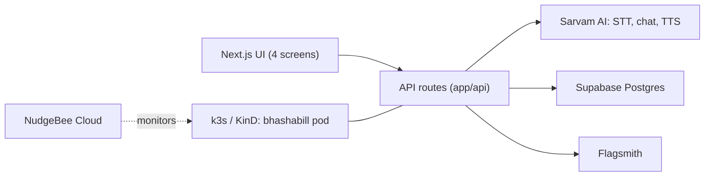

# BhashaBill

> Festive vendors take orders by voice and argue about them later. BhashaBill turns the spoken order into a
> bill the customer can see before the dispute starts.

Speak an order in Kannada, Hindi, Tamil or English. BhashaBill transcribes it, extracts an itemised bill,
lets the vendor review and edit it, and gives the customer a shareable bilingual bill page. The vendor tracks
balances and sends reminders from a dashboard.

Built for **Festive Hacks x WeAreDevelopers Conference India**, Bengaluru, 25 Nov 2026.

## Demo
- Live: TODO
- Video: TODO

## Architecture



Pipeline: audio (MediaRecorder) → `POST /api/transcribe` → Sarvam STT → Sarvam chat extraction (JSON only) →
zod validation → Review screen → `POST /api/orders` → public `/b/[slug]`.

Money is always computed in code (`lib/money.ts`), never by the model. The server recomputes every amount,
total and balance; client totals are ignored. The vendor always reviews the bill before it is saved.

## Screens
1. New Order (`/`): record or type the order
2. Review Bill (`/review`): editable items, totals, advance, due date
3. Public Bill (`/b/[slug]`): what the customer sees
4. Dashboard (`/orders`): balances, payments, reminders

## Sponsors

### Sarvam AI (verified model names)
| Use | Endpoint | Model |
|---|---|---|
| Speech-to-text (`mode=codemix`, sweet-shop keyterms) | `/speech-to-text` | `saaras:v4` |
| Bill extraction (strict JSON) | `/v1/chat/completions` | `sarvam-105b-conversations` |
| Spoken bill readback | `/text-to-speech` | `bulbul:v4-flash` (speaker `shubh_enhi_ads`) |

### Flagsmith
| Flag | Type | Purpose |
|---|---|---|
| `reminder_templates` | Remote config JSON `{"polite": "...", "firm": "..."}` | Reminder wording with `{name}`, `{balance}`, `{date}`; edit without redeploy |
| `reminder_tone_test` | Multivariate (`polite` / `firm`) | A/B test per customer; identity = customer phone or order slug; variant logged in `reminders` |
| `tts_readback` | Boolean | Shows/enables the spoken bill summary |

Identity traits sent on reminders: `is_overdue`, `language`, `balance`. Use them to build segments, e.g.
`is_overdue = true` → serve `firm`.

### NudgeBee
NudgeBee Cloud monitors the deployed service on Kubernetes. A demo-only endpoint simulates an incident
(the incident is simulated; the monitoring and investigation are real):

```bash
# set ENABLE_STRESS_ENDPOINT=true on the deployment first
curl "http://<host>/api/debug/stress?ms=8000&mb=200"   # CPU + memory pressure
curl "http://<host>/api/debug/stress?mode=error"       # HTTP 500
```

Setup: connect the cluster to NudgeBee Cloud (install their agent per their onboarding), then watch the
`bhashabill` deployment. Pod limits are 250m/500m CPU and 256Mi/512Mi RAM so stress triggers a visible incident.
Keep `ENABLE_STRESS_ENDPOINT=false` outside the demo.

## Run locally
```bash
git clone https://github.com/Rithvik-krishna/BhashaBill.git && cd BhashaBill
npm install
cp .env.example .env.local   # fill in the values
# Supabase SQL editor: run supabase/schema.sql, then supabase/seed.sql
node --env-file=.env.local scripts/smoke-services.mjs   # verify Sarvam, Supabase, Flagsmith
# set NEXT_PUBLIC_USE_MOCKS=false in .env.local
npm run dev                                             # http://localhost:3000
node scripts/smoke-api.mjs                              # end-to-end API check
```

## Docker
```bash
docker compose up --build   # uses .env.local, serves on :3000
```

## Kubernetes (single-node k3s, or local KinD)
```bash
docker build -t bhashabill:latest .            # for KinD: kind load docker-image bhashabill:latest
kubectl create secret generic bhashabill-env --from-env-file=.env.local
kubectl apply -f k8s/
```
- `livenessProbe`: `/api/health?probe=live` (always 200)
- `readinessProbe`: `/api/health` (checks Supabase, 503 if unreachable)

## Environment variables
See `.env.example`: `SARVAM_API_KEY`, `SARVAM_BASE_URL`, `SARVAM_STT_MODEL`, `SARVAM_CHAT_MODEL`,
`SARVAM_TTS_MODEL`, `SARVAM_TTS_SPEAKER`, `SUPABASE_URL`, `SUPABASE_SERVICE_ROLE_KEY`,
`FLAGSMITH_ENVIRONMENT_KEY`, `NEXT_PUBLIC_BASE_URL`, `NEXT_PUBLIC_USE_MOCKS`, `ENABLE_STRESS_ENDPOINT`.

## Team
Rithvik (frontend), Chris (backend and integrations)
